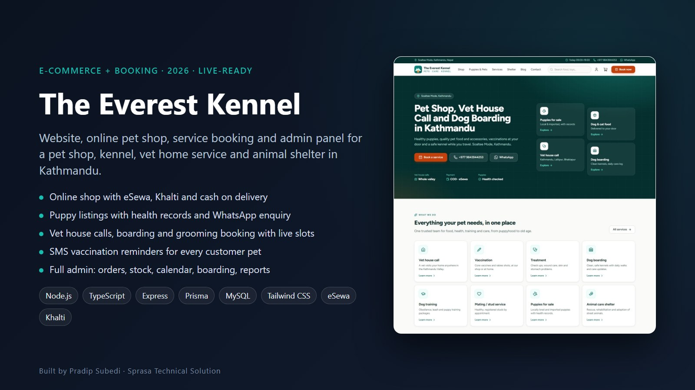
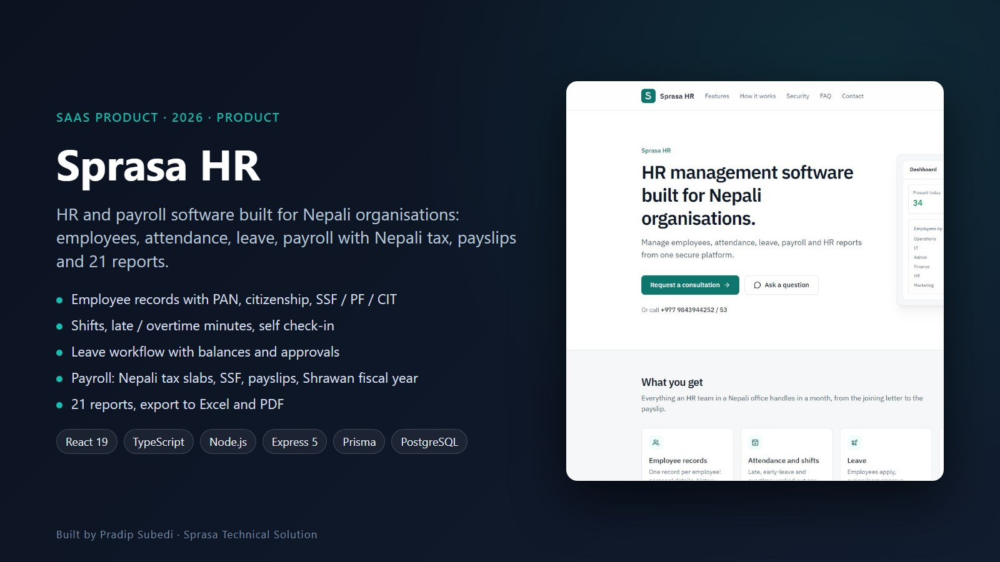
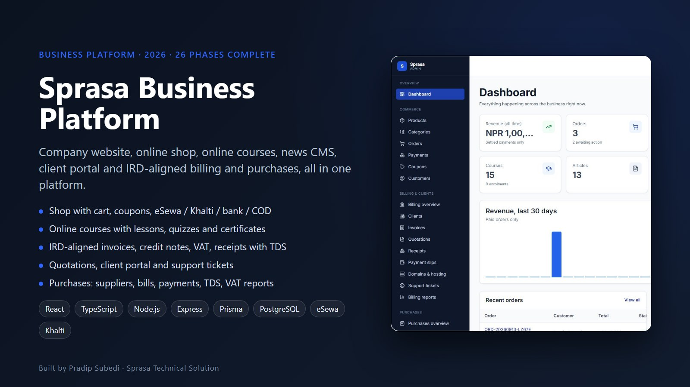
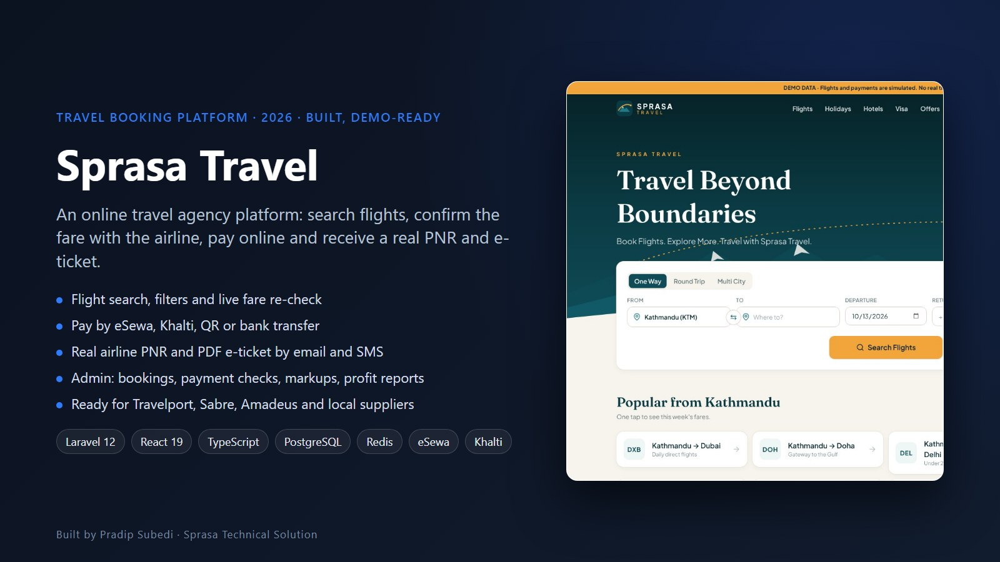
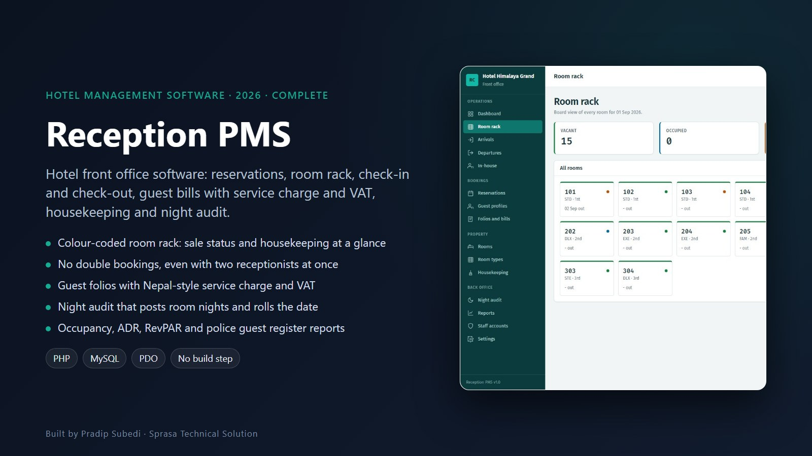
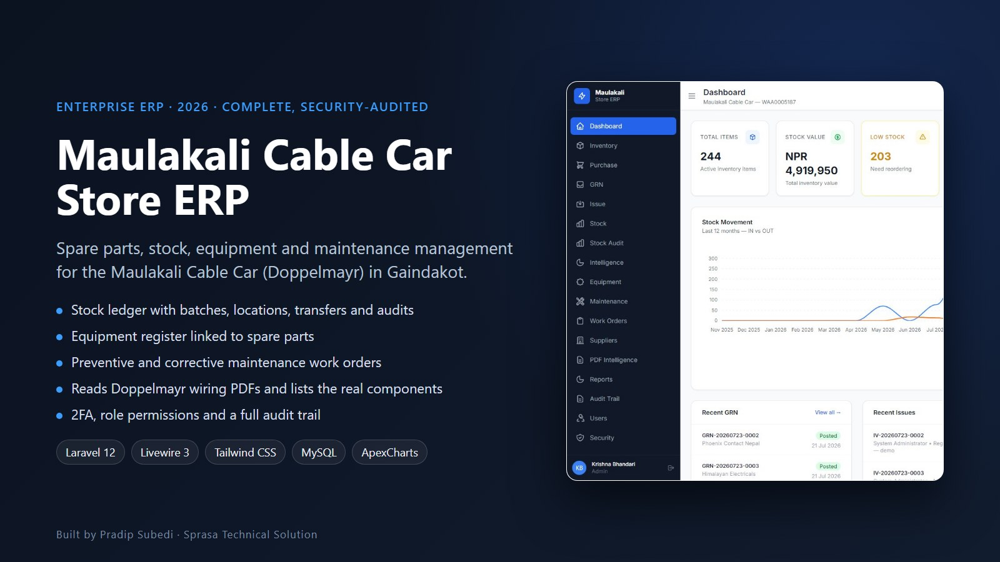
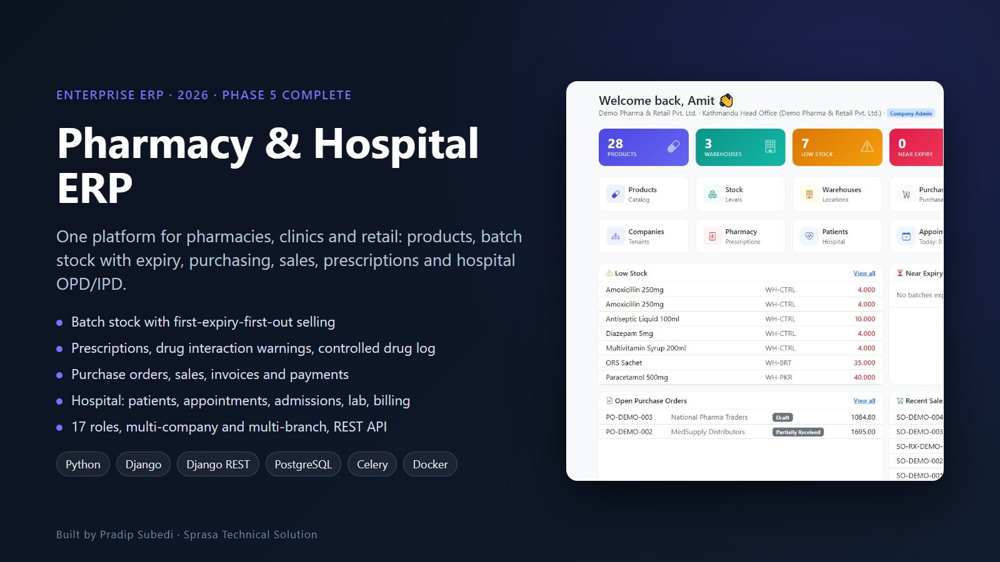
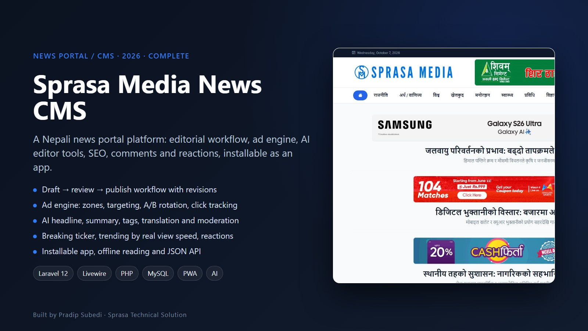
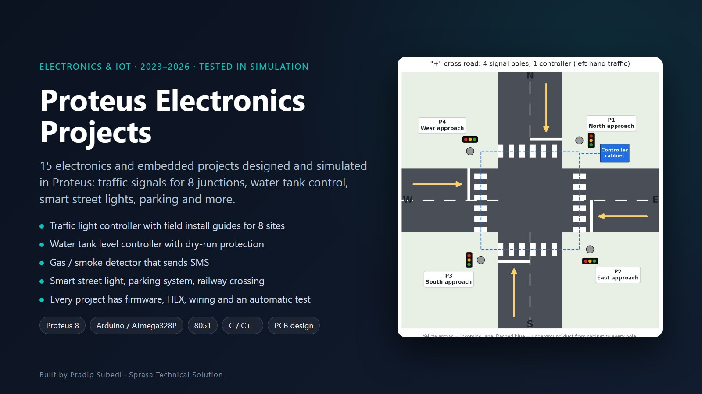

# Sprasa Technical Solution

**Websites, business software and IT solutions for Nepal**
Ratnanagar-10, Chitwan · Registered company (Reg. No. 401941/83/84)

[Website](https://sprasatechnicalsolution.com.np) · [Get a quote](https://sprasatechnicalsolution.com.np/contact) · [Free Nepali Unicode converter](https://sprasatechnicalsolution.com.np/nepali-unicode)

---

We design, build and look after the websites and systems Nepali businesses actually run on: one team in Chitwan, from the first idea to hosting and support.

## What we do

| | |
|---|---|
| 🌐 **Business websites** | Fast, mobile-first sites with SEO, WhatsApp and call buttons, and an admin panel to edit everything |
| 🛒 **E-commerce** | Online shops with eSewa, Khalti and cash on delivery, plus stock and order management |
| 📅 **Booking systems** | Appointments, services and travel with live slots, SMS/OTP and reminders |
| 🧾 **Business software** | HR and payroll, IRD-aligned billing and accounting, ERP, CRM, hotel front office |
| 📰 **News portals** | Newsroom CMS, ad management, Nepali Unicode publishing |
| 🎓 **Education** | Consultancy CRM, school and college websites, online courses with certificates |
| 🎨 **Design and video** | Social media kits, print menus, promo videos with Nepali voice-over |
| ⚡ **Engineering and IoT** | Control systems, embedded firmware, PCB design |
| ☁️ **Hosting and support** | `.com.np` domains, deployment, security audits and maintenance |

## Selected work

<table>
<tr>
<td width="50%"> <b>The Everest Kennel</b> Pet shop, puppy sales, vet booking, boarding and shelter platform</td>
<td width="50%"> <b>Sprasa HR</b> HR and payroll for Nepali organisations: attendance, leave, tax, payslips</td>
</tr>
<tr>
<td> <b>Sprasa Business Platform</b> Website, shop, courses, client portal and IRD-aligned billing in one system</td>
<td> <b>Sprasa Travel</b> Online travel agency: flight search, payment, PNR and e-tickets</td>
</tr>
<tr>
<td> <b>Reception PMS</b> Hotel front office: room rack, reservations, VAT bills, night audit</td>
<td> <b>Maulakali Cable Car Store ERP</b> Spare parts, stock, equipment and maintenance for a cable car</td>
</tr>
<tr>
<td> <b>Pharmacy & Hospital ERP</b> Batch stock with expiry, prescriptions, sales, hospital OPD/IPD</td>
<td> <b>Sprasa Media News CMS</b> News portal with newsroom workflow, ad engine and AI tools</td>
</tr>
<tr>
<td> <b>Study Lane Chitwan</b> Study-abroad consultancy website with a student CRM</td>
<td> <b>Mexican Taco Design Kit</b> 170 editable social, banner and print designs for a restaurant</td>
</tr>
<tr>
<td> <b>Nepali Unicode Converter</b> · open source Preeti / Romanized / Unicode for web, PHP and WordPress</td>
<td> <b>Proteus Electronics Projects</b> · open source 15 embedded projects: traffic signals, water tanks, parking and more</td>
</tr>
</table>

More open-source work: [AI Skills Pack](https://github.com/sprasapradip/ai-skills) · [Underground cable fault detection (ANN)](https://github.com/sprasapradip/underground-transmission-line-fault-detection-using-ann) · [Fastkhabar Online](https://github.com/sprasapradip/fastkhabar-online) · [Nepal Sandes](https://github.com/sprasapradip/nepal-sandes)

## Technology we use

`PHP` `Laravel` `Node.js` `Express` `TypeScript` `React` `Python` `Django` `FastAPI` `MySQL` `PostgreSQL` `Prisma` `Tailwind CSS` `WordPress` `Docker` `eSewa` `Khalti` `Arduino` `Proteus`

## Contact

🌐 [sprasatechnicalsolution.com.np](https://sprasatechnicalsolution.com.np)
✉️ info@sprasatechnicalsolution.com.np
👤 [Pradip Subedi](https://github.com/sprasapradip) · [pradipsubedi1.com.np](https://pradipsubedi1.com.np)

© Sprasa Technical Solution Pvt. Ltd. Project images are demo data and belong to their respective clients.
